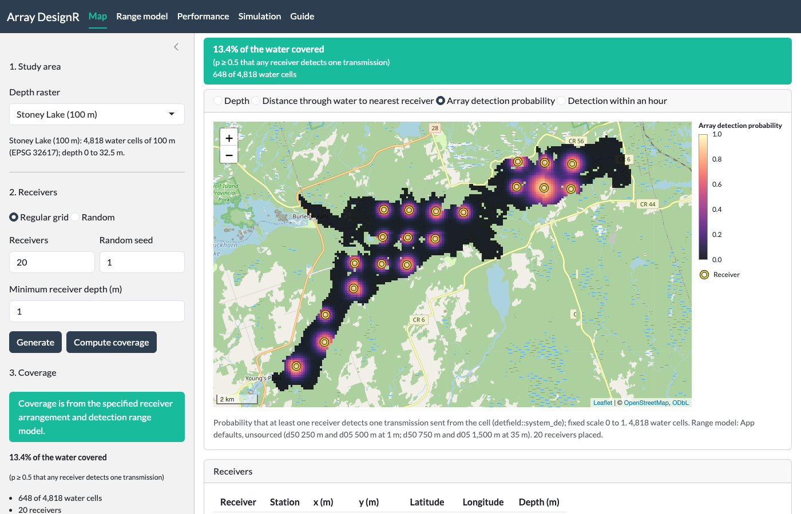
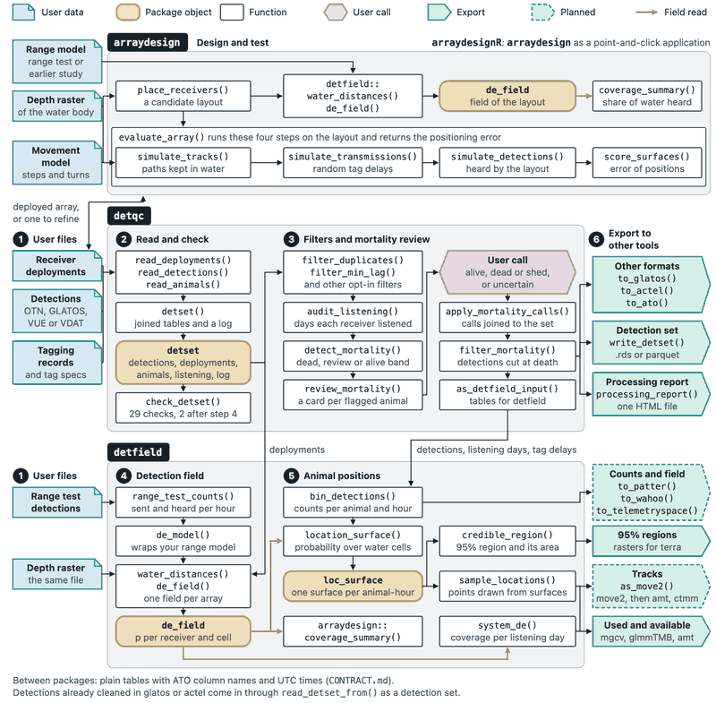

<!-- README.md is generated from README.Rmd. Edit README.Rmd, then knit it. -->

# arraydesignR 

[-blue.svg)](https://www.gnu.org/licenses/gpl-3.0)

**arraydesignR** is a Shiny application for designing an acoustic receiver array on the depth
raster of an aquatic ecosystem. It is a GUI version of the
[**arraydesign**](https://jakebrownscombe.github.io/arraydesign/) R package. It adds
functionality to click to place or remove receiver locations and to run the design functions
without directly using R scripts. The application takes a GeoTIFF of water depth, a receiver
layout and a range model (receiver locations and range models can be generated within the
application), maps the
probability that the array detects a transmission from each water cell, and simulates tagged
animals to count how often they are detected. Receiver placement and the simulation come from
**arraydesign**; distances through water and detection fields come from the
[**detfield**](https://jakebrownscombe.github.io/detfield/) R package, so the application and the
packages give the same numbers for the same layout.

## Install

``` r
install.packages("remotes")
remotes::install_github(c("jakebrownscombe/detfield",
                          "jakebrownscombe/arraydesign",
                          "jakebrownscombe/arraydesignR"))

# Start the app in your browser, on the Stoney Lake depth raster
if (interactive()) arraydesignR::run_app()
```

To install all four positionR packages at once, see the
[**positionR**](https://jakebrownscombe.github.io/positionR/) landing page.

## Example

The app opens on the depth raster with no receivers. Click the map to add a receiver, or press
**Generate** to place 20 on a grid, then press **Compute coverage**. Once coverage is computed, a
change to the layout turns the banner amber until it is computed again.



*The Map tab after **Generate** and **Compute coverage** at the default settings: the array
detection probability of each water cell under the 20 receivers, over an OpenStreetMap base
map.*

## Articles

- [The app, tab by tab](https://jakebrownscombe.github.io/arraydesignR/articles/arraydesignR.html) (Get started): the app on Stoney Lake at its
  default settings in five sections, four with a screenshot of their tab, and the R calls that give the numbers it
  shows.
- The [articles](https://jakebrownscombe.github.io/arraydesign/articles/index.html) of **arraydesign**
  give the code behind the app in full: comparing candidate arrays, setting how the simulated
  animals move, and simulating an array step by step.

## The suite

**arraydesignR** is the application of positionR, four packages that take a telemetry study from array
design to positions.



- [positionR, the suite](https://jakebrownscombe.github.io/positionR/)
- [**detqc**](https://jakebrownscombe.github.io/detqc/): read, check and filter detections.
- [**detfield**](https://jakebrownscombe.github.io/detfield/): detection fields and positions.
- [**arraydesign**](https://jakebrownscombe.github.io/arraydesign/): design and test the performance of tracking systems.
- [**arraydesignR**](https://jakebrownscombe.github.io/arraydesignR/): **arraydesign** as a point-and-click application.

## Cite

Brownscombe J (2026). *positionR: tools for acoustic telemetry studies*. R package version
2.0.0, <https://jakebrownscombe.github.io/positionR/>.

Brownscombe J (2026). *arraydesignR: Shiny App for Designing Acoustic Receiver Arrays*. R
package version 0.1.0, <https://jakebrownscombe.github.io/arraydesignR/>.

## How the code was written

The code and this documentation were written with an AI coding assistant, Claude Code v2.1.145.

## Licence

GPL (\>= 3).
