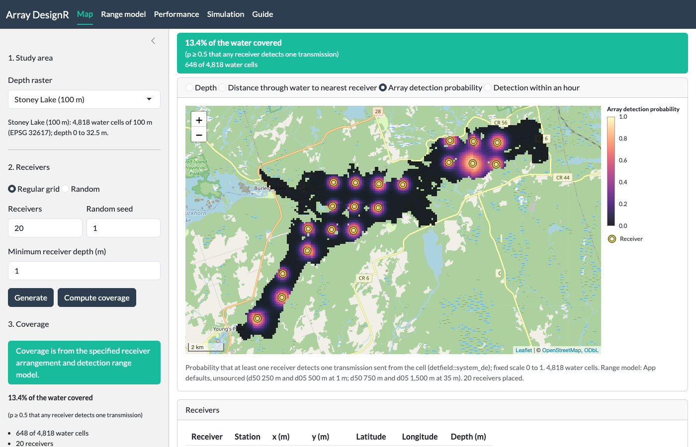
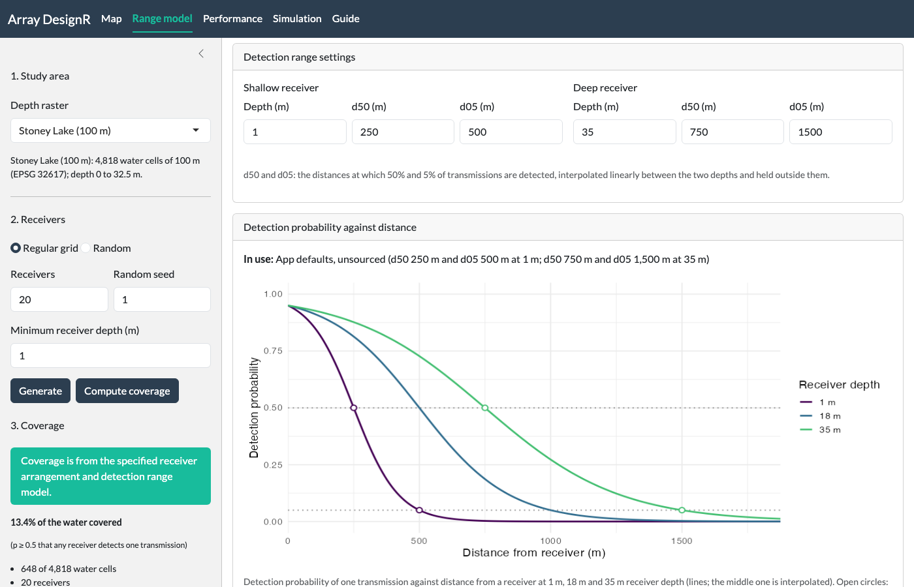
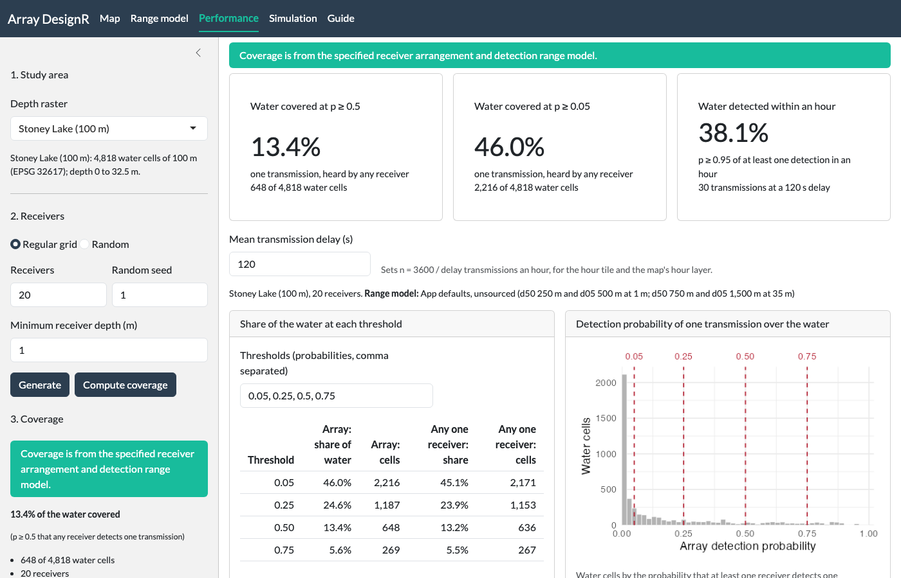
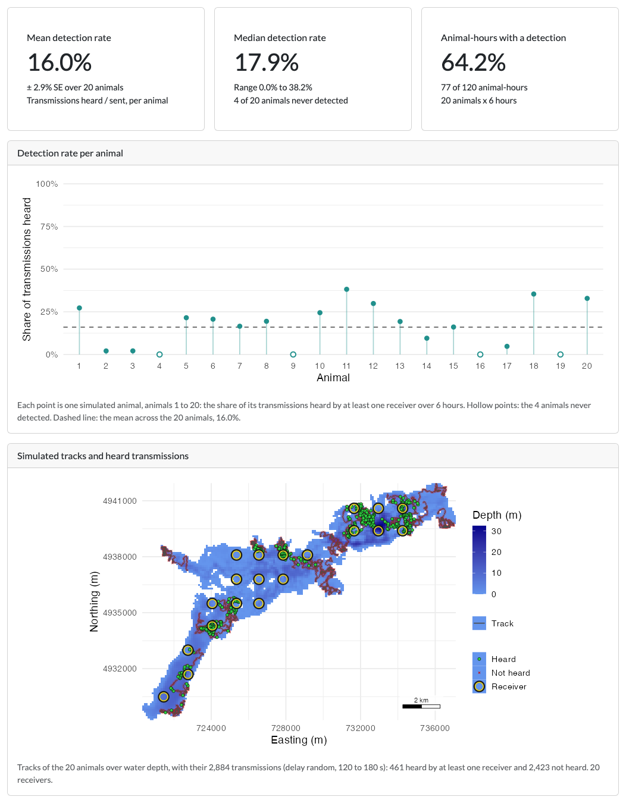

```{r setup, include = FALSE}
# The chunks run on the installed packages. Messages and warnings are hidden
# except on the two de_field() chunks, whose note on land between receivers
# and cells the page explains.
knitr::opts_chunk$set(collapse = TRUE, comment = "#>", message = FALSE,
                      warning = FALSE)
# Output wraps at 76 characters, so a line with its "#> " prefix fits in 80.
options(width = 76)
```

**arraydesignR** is a point-and-click application that designs acoustic receiver arrays and
tests the performance of tracking systems, for a new study or to refine an array already in the
water. It maps the probability that the array detects a transmission from each water cell,
reports the share of the water it covers, and simulates tagged animals to count how often they
are detected. Receivers are placed by clicks on the map, on a grid, at random or from a CSV
file, and the range model is typed in on its own tab. Receiver placement and the simulation come
from the [**arraydesign**](https://jakebrownscombe.github.io/arraydesign/) R package; distances
through water, detection fields and array detection probability come from the
[**detfield**](https://jakebrownscombe.github.io/detfield/) R package.

The sections below follow the app on Stoney Lake at its default settings, tab by tab, with the R calls
that return the numbers each tab shows. The articles of **arraydesign** go further in R:
[the article on designing an array from your own files](https://jakebrownscombe.github.io/arraydesign/articles/design-an-array.html),
[the article on movement models](https://jakebrownscombe.github.io/arraydesign/articles/movement-models.html) and
[the article on each part of a simulation](https://jakebrownscombe.github.io/arraydesign/articles/simulate-detections.html). Each is linked again
in the section it extends.

`run_app()` starts the app in the browser. In a knitted page such as this one the line does
nothing.

```{r run-app}
# Start the app in an R session
if (interactive()) arraydesignR::run_app()
```

## 1. Study area and receivers

The app opens on Stoney Lake, Ontario. Another water body is uploaded as a GeoTIFF of water depth with
land as NA. In the sidebar you choose a regular grid or a random draw, the number of receivers,
the random seed and a minimum receiver depth, then press **Generate**. A click on the map adds or
removes one receiver, and a CSV file of receivers can be uploaded. The app opens on the depth
raster with no receivers; **Generate** at the default settings places 20 receivers on the grid,
seed 1, at least 1 m deep.

Read the depth raster the app opens on. It returns a `SpatRaster` with depth as zero or
negative metres and land as NA. It is a 100 m depth raster of Stoney Lake derived from the
bathymetry made before 2024, with the same grid and depths as `depth_raster` of positionR 1.7.0
and the CRS set to EPSG:32617.

```{r read-lake}
library(terra)
# Stoney Lake, the depth raster bundled with the app
lake <- rast(system.file("extdata", "stoney_depth.tif",
                         package = "arraydesignR"))
# Count the water cells, and the water cells that hold 0
sum(!is.na(values(lake)))
sum(values(lake) == 0, na.rm = TRUE)
# Give the range of the depths (m)
range(abs(values(lake)), na.rm = TRUE)
```

The cells are 100 m square, in UTM zone 17N (EPSG 32617).
`r sum(values(lake) == 0, na.rm = TRUE)` of the
`r format(sum(!is.na(values(lake))), big.mark = ",")` water cells hold 0.

Set water shallower than the minimum receiver depth to NA, as the app does. The cells left are
the ones a receiver may occupy.

```{r deployable}
# Keep the cells at least 1 m deep
deployable <- ifel(abs(lake) >= 1, lake, NA)
# Count the cells a receiver may occupy
sum(!is.na(values(deployable)))
```

Place the receivers on what is left with `arraydesign::place_receivers()`. It returns one row
per receiver, with its position and its depth in `deploy_z`. To start from your own receiver
file and compare candidate layouts, see
[the article on designing an array from your own files](https://jakebrownscombe.github.io/arraydesign/articles/design-an-array.html).

```{r receivers}
# Place 20 receivers on a regular grid, seed 1
receivers <- arraydesign::place_receivers(deployable, n = 20,
                                          method = "grid", seed = 1)
# How many receivers, and how deep they sit (m)
nrow(receivers)
range(receivers$deploy_z)
```

The screenshot shows this layout in the app. The colour under the receivers is the coverage,
which [section 3](#coverage-and-the-map-layers) computes.

```{r app-map, echo = FALSE, out.width = "100%", fig.alt = "Screenshot of the app's Map tab: sidebar at left, coverage map of Stoney Lake at right."}

```

*The Map tab after **Generate** and **Compute coverage** at the default settings: the array
detection probability of each water cell under the 20 receivers, over an OpenStreetMap base
map.*

## 2. Range model

Detection probability falls with distance on a logistic curve through 0.5 at d50 and 0.05 at
d05. On the Range model tab you set d50 and d05 at a shallow and a deep receiver depth. Both are
interpolated linearly by each receiver's depth and held at the nearer depth outside the two.
Every water body opens on the app defaults, which the next chunk sets. No range test stands behind
these values; replace them with the d50 and d05 of your own range test. The two-distance curve
is a stand-in for a study with no range test. In R, a model fitted to a range test, varying with
depth and date, goes in through `detfield::de_model()`
(see the [article on range models](https://jakebrownscombe.github.io/detfield/articles/range-model.html) of **detfield**).

Build the default curve with `detfield::de_logistic()`. It returns a detection model whose
`curve$predict` element gives the logit of detection probability at a distance and a receiver depth.

```{r curve}
# The app defaults: d50 and d05 at a 1 m and a 35 m receiver
curve <- detfield::de_logistic(d50 = c(250, 750), d05 = c(500, 1500),
                               depth = c(1, 35))
curve
```

Read the curve at 0 m, d50 and d05 for a receiver 1 m deep. `curve$predict` returns the logit, and
`plogis()` turns it into a probability.

```{r curve-check}
# Detection probability at 0, 250 and 500 m from a 1 m receiver
plogis(curve$predict(c(0, 250, 500), depth_m = 1))
```

Because d05 is twice d50, detection at 0 m is 0.95. The closer d05 sits to d50, the nearer
the curve starts to 1.

The app leaves out cells farther from every receiver than the distance at which the curve falls
below 0.001. The curve reaches farthest for the deepest receivers, so that distance is read at 35 m.

```{r cutoff}
# The first whole metre at which a 35 m receiver detects with p < 0.001
distance_m <- 0:5000
p_deep <- plogis(curve$predict(distance_m, depth_m = 35))
cutoff_m <- min(distance_m[p_deep < 0.001])
cutoff_m
```

```{r app-range-model, echo = FALSE, out.width = "100%", fig.alt = "Screenshot of the app's Range model tab: range settings above, detection curves below."}

```

*The Range model tab at the defaults. Open circles mark d50 and d05 on the curves of the two
set depths.*

## 3. Coverage and the map layers

**Compute coverage**, in the sidebar of the Map tab, gives for every water cell the probability
that at least one receiver detects one transmission. It is drawn on the Map tab, in the
screenshot of section 1. This is the coverage of Pedersen et al. (2014, *Methods in Ecology and
Evolution* 5: 1043-1051, <https://doi.org/10.1111/2041-210X.12255>). The map has four layers:
depth, distance through water to the nearest receiver, array detection probability, and
detection within an hour (section 4).

Measure the distance through water from each receiver to each water cell, up to the cutoff.
`detfield::water_distances()` returns one row per receiver-cell pair within it.

```{r distances}
# Distances through water from the 20 receivers, up to the cutoff
distances <- detfield::water_distances(
  lake, receivers[c("station_id", "x", "y", "deploy_z")],
  max_distance = cutoff_m
)
nrow(distances)
```

Read the curve at each distance with `detfield::de_field()`. It returns the detection
probability of each receiver at each cell, and warns where land lies on the straight line
between a receiver and a cell.

```{r field, message = TRUE, warning = TRUE}
# Detection probability of each receiver at each cell
field <- detfield::de_field(distances, curve)
```

The app keeps the default, `blocked = 0`, so behind islands and points of land the map
overstates detection. In R, a negative `blocked` value in `detfield::de_model()` lowers detection
on those pairs, and `-Inf` makes a receiver deaf to them.

Combine the receivers with `detfield::system_de()`. It needs the days each receiver listened;
one day for all 20 gives the coverage of the layout.

```{r coverage}
# One listening day for every receiver in the field
listening <- data.frame(station_id = field$receivers,
                        date = as.Date("2000-01-01"))
# Probability that at least one receiver detects one transmission, per cell
coverage <- detfield::system_de(field, listening)$p
length(coverage)
```

Count the water cells at a probability of 0.5 or more, the share the Map tab's banner reports.

```{r share-half}
# Cells and share of the water at p >= 0.5
sum(coverage >= 0.5)
mean(coverage >= 0.5)
```

## 4. Performance

The Performance tab reads the last coverage result, so press **Compute coverage** again after a
change to the layout or the range model. The share at 0.5 above is its first tile; the next two
chunks give the other two.

Count the water cells at 0.05 or more.

```{r share-low}
# Cells and share of the water at p >= 0.05
sum(coverage >= 0.05)
mean(coverage >= 0.05)
```

The hourly probability is p_hour = 1 - (1 - p)^n, with n = 3600 / delay transmissions an hour
at the mean transmission delay set on the tab (120 s to start, so n = 30). It assumes that
successive transmissions are detected independently; where detection is clustered in time,
p_hour overstates the chance of a detection. The chunk computes p_hour for every water cell and
counts the cells at 0.95 or more.

```{r share-hour}
# Probability of at least one detection in an hour, 30 transmissions
p_hour <- 1 - (1 - coverage)^(3600 / 120)
# Cells and share of the water at p_hour >= 0.95
sum(p_hour >= 0.95)
mean(p_hour >= 0.95)
```

`arraydesign::coverage_summary()` counts the cells where a single receiver reaches each threshold on
its own. It returns one row per threshold.

```{r single-receiver}
# Cells reached by the best single receiver at 0.05 and 0.5
single_receiver <- arraydesign::coverage_summary(field,
                                                 thresholds = c(0.05, 0.5))
single_receiver
```

These are the "Any one receiver" columns of the tab's table, at 0.05 and 0.5. The
`r sum(coverage >= 0.5) - single_receiver$n_cells[single_receiver$threshold == 0.5]` cells that
the array reaches at 0.5 and no single receiver does are reached only through the overlap of two
or more receivers.

```{r app-performance, echo = FALSE, out.width = "100%", fig.alt = "Screenshot of the app's Performance tab: three tiles, the coverage table and a histogram."}

```

*The Performance tab after **Compute coverage** at the default settings.*

## 5. Simulation

The Simulation tab walks animals through the water on a correlated random walk, sends their
transmissions at a random delay between a shortest and a longest delay, and each receiver hears
each transmission, or not, under the range model. The detection rate of an animal is the share of its
transmissions heard by at least one receiver. The tab computes no positions.

Set the movement model with `arraydesign::crw_model()`. The values are the app's starting ones;
no species was measured for them. To set a walk for your species, see
[the article on movement models](https://jakebrownscombe.github.io/arraydesign/articles/movement-models.html).

```{r walk}
# Correlated random walk: mean step 30 m (SD 15 m) per 60 s, turning SD 40
walk <- arraydesign::crw_model(step_mean = 30, step_sd = 15, turn_sd = 40,
                               time_step_s = 60)
walk
```

Walk 20 animals for 6 hours on the lake with `arraydesign::simulate_tracks()`. It returns one
row per animal per time step.

```{r tracks}
# 20 animals, 360 steps of 60 s each, seed 1
tracks <- arraydesign::simulate_tracks(lake, walk, n_animals = 20,
                                       n_steps = 6 * 3600 / 60, seed = 1)
nrow(tracks)
```

Send transmissions along each track at a delay drawn between 120 and 180 s.
`arraydesign::simulate_transmissions()` returns one row per transmission.

```{r transmissions}
# Transmissions at a random delay of 120 to 180 s, seed 1
transmissions <- arraydesign::simulate_transmissions(
  tracks, tag_delay = c(120, 180), seed = 1
)
nrow(transmissions)
```

Build a detection field over the whole lake. It is the field of section 3 with no cutoff, because
an animal can be anywhere on the lake.

```{r field-lake, message = TRUE, warning = TRUE}
# Distances through water from the 20 receivers to every water cell
distances_lake <- detfield::water_distances(
  lake, receivers[c("station_id", "x", "y", "deploy_z")]
)
# Detection probability of each receiver at every water cell
field_lake <- detfield::de_field(distances_lake, curve)
```

Detect each transmission under the curve with `arraydesign::simulate_detections()`. It returns
the number of receivers that heard each transmission.
[The article on each part of a simulation](https://jakebrownscombe.github.io/arraydesign/articles/simulate-detections.html) shows every table
between tracks and detections.

```{r detections}
# Detect each transmission, with no extra variation between receivers
detections <- arraydesign::simulate_detections(
  transmissions, field_lake, overdispersion = "none", seed = 1
)
# Transmissions heard by at least one receiver
heard <- detections$transmissions$n_detections > 0
sum(heard)
```

Summarise the detection rate across animals. The chunk returns the mean, SE, median and range
in percent, then the number of animals never detected.

```{r rate}
# Share of each animal's transmissions heard
detection_rate <- tapply(heard, transmissions$path_id, mean)
# Mean, SE, median and range of the rate across animals (%)
round(100 * c(mean = mean(detection_rate),
              se = sd(detection_rate) / sqrt(length(detection_rate)),
              median = median(detection_rate),
              min = min(detection_rate), max = max(detection_rate)), 1)
# Animals never detected
sum(detection_rate == 0)
```

Count the animal-hours with at least one detection. The walk starts at the first hour of 2025
in UTC, and the app counts hours from there.

```{r animal-hours}
# Hour of the walk, 0 to 5, of each transmission; the last second counts
# in hour 5, as in the app
walk_start <- as.POSIXct("2025-01-01", tz = "UTC")
hours_in <- as.numeric(difftime(transmissions$datetime, walk_start,
                                units = "hours"))
hour_of_walk <- pmin(5, floor(hours_in))
# Whether each animal was heard in each hour
heard_by_hour <- tapply(heard, list(transmissions$path_id, hour_of_walk),
                        any)
sum(heard_by_hour, na.rm = TRUE)
```

The chunks above print the numbers on the tiles of the Simulation tab below. The rates depend
on the movement model and the range model, so use them to compare layouts on the same settings.

```{r app-simulation, echo = FALSE, out.width = "100%", fig.alt = "Screenshot of the app's Simulation tab: three tiles, the rate per animal and the track map."}

```

*The Simulation tab after one run at the default settings, 20 animals for 6 hours, seed 1.*

